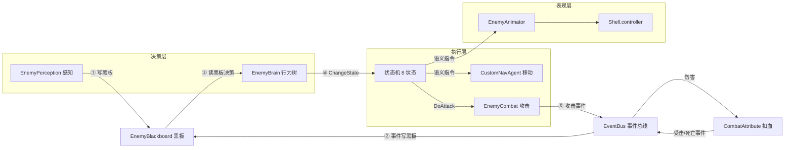
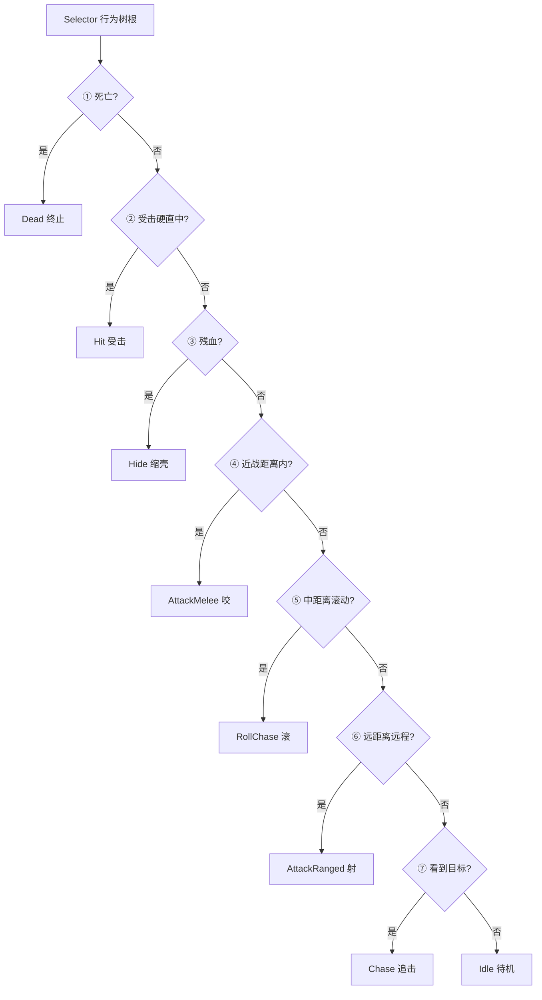

# 14. 阶段五行为树升级 策划方案

> 承接：`12.阶段四怪物远程缩壳滚动策划方案.md`、`13.阶段四手把手实现手册`
> **一句话目标**：把散落在 8 个状态类里的"决策逻辑"收敛到一棵**行为树**，实现"决策与执行分离"，为换怪、加行为、加复杂 AI 铺路。

---

## 一、为什么要做第五阶段（价值与解决的问题）

### 1.1 现状的问题：决策逻辑"散了"

前四阶段用**状态机（FSM）**做完了螃蟹的全部行为，但决策逻辑已经出现三个坏味道：

| 问题 | 具体表现 |
| -- | -- |
| **决策分散** | "该做什么"的判断散在 8 个状态类里：`ChaseState` 有一长串 if-else（残血→缩壳、近战→咬、滚动→滚、远程→放），`IdleState` 有"看到就追"，`AttackMeleeState` 有"硬直结束回追击"…… |
| **加行为要动多处** | 加一个新行为，除了新状态类，还得去改 `ChaseState` 的 if-else，甚至改多个状态类的转移 |
| **换怪要改决策** | 终极目标"换一只怪只换动画、决策零改动"还没兑现——决策和状态类耦合，换怪时决策代码跟着动 |

### 1.2 行为树解决的问题

行为树（Behavior Tree）把"决策"和"执行"拆成两层：

```text
决策层（行为树）  ：每帧回答"现在该做哪个动作"，按优先级从高到低找
执行层（状态类）  ：每个动作怎么做（OnEnter/OnUpdate/OnExit 生命周期）
```

- **决策集中**：8 个状态的优先级选择，收敛到一棵树，一眼看清、一处修改。
- **加行为 = 加一个节点**：往树里插一个 `Sequence(条件, 动作)`，其他节点零改动。
- **换怪零改动**：决策树只依赖黑板（距离/血量/冷却）+ 参数，与具体怪物无关。

> 这也是答辩里的关键素材：从"状态机"到"行为树"的演进，回答"为什么不用现成行为树插件"时——**因为决策与执行的解耦本身就是研究对象**。

### 1.3 为什么是"轻量行为树"而不是完整行为树

完整行为树还包含"条件性中断（conditional abort）""装饰器（repeat/until）"等机制，实现复杂。本阶段采用**务实折中**：

- 用**无记忆 + 每帧从根重求值**实现"优先级动态变化"（残血时自动切缩壳，无需显式中断）。
- 动作的**生命周期（进入/退出）**交给已有的状态机（`OnEnter/OnUpdate/OnExit`），不重复造轮子。
- 中断机制（装饰器/abort）留作未来增强。

> 这就是"行为树决策 + 状态机执行"的混合架构——**各取所长**：BT 擅长优先级选择，FSM 擅长有记忆的连续动作。

---

## 二、目标与范围

### 2.1 目标

端到端验证：螃蟹的**全部 8 个行为**（追/咬/远程/缩壳/受击/死亡/滚动）在行为树驱动下**行为与前四阶段完全一致**，但决策逻辑收敛到一棵树。

### 2.2 功能清单

| 模块 | 内容 | 新增/修改 |
| -- | -- | -- |
| 行为树框架 | `BTNode`(基类) / `Selector`(优先级) / `Sequence`(顺序) / `Condition`(条件) / `ActionNode`(动作) | 新增 5 文件 |
| 决策树 | `EnemyBrain.BuildTree()` 把 8 个状态的优先级写成一棵树 | 修改 |
| 决策集中 | `IdleState`/`ChaseState` 移除内部决策，只留"执行" | 修改 2 文件 |
| 黑板扩展 | 加 `LastHitTime`（受击时间戳，供行为树判断 Hit） | 修改 |
| 事件语义化 | `OnDamaged` 只写黑板、不再直接切状态（决策权上交行为树） | 修改 |

### 2.3 范围外（本阶段严格不做）

```text
├─ 条件性中断(conditional abort) / 装饰器节点(repeat/until/inverter)
├─ 行为树可视化编辑器(先用代码建树)
├─ 第二只怪物接入(换怪验证,行为树做完后另行开展)
├─ 巡逻(Patrol)等新行为(本阶段只做"决策重构",不加新行为)
└─ 性能优化(树很小,每帧重求值开销可忽略)
```

---

## 三、核心设计

### 3.1 架构：行为树（决策）+ 状态机（执行）

```text
EnemyBrain.Update
  ├─ 1. _perception.Tick(BB)        感知写黑板
  ├─ 2. _root.Evaluate(this)        行为树决策:按优先级 ChangeState 到目标状态
  └─ 3. _currentState.OnUpdate(this) 状态执行(含"动作完成→切走"的转移)

行为树(根 Selector)
  ├─ Sequence(死亡条件,   Action(Dead))
  ├─ Sequence(受击条件,   Action(Hit))
  ├─ Sequence(残血条件,   Action(Hide))
  ├─ Sequence(近战条件,   Action(AttackMelee))
  ├─ Sequence(滚动条件,   Action(RollChase))
  ├─ Sequence(远程条件,   Action(AttackRanged))
  ├─ Sequence(看到目标,   Action(Chase))
  └─ Action(Idle)                    兜底
```

#### 配套架构图一：整体架构与数据流转路径

> 与 3.1 的代码结构一一对应：三层架构（决策/执行/表现）+ 右侧黑板与事件总线。编号 ①~⑥ 标出一帧内的数据流转。



> 数据流转六步：**①** 感知每帧把"目标/距离/视野"写进黑板 → **②** 受击事件把"受击时间戳/血量"写进黑板 → **③** 行为树读黑板按优先级决策 → **④** `ChangeState` 切状态 → **⑤** 状态发语义指令（移动/动画/攻击）→ **⑥** 攻击发事件、结算伤害、再广播受击/死亡事件回到 ②，形成闭环。

### 3.2 两个关键设计

**① ActionNode 只做"切换 + 持续"**：

```csharp
public override NodeState Evaluate(EnemyBrain brain)
{
    brain.ChangeState(_stateType);   // 切到目标状态(ChangeState 有同状态保护)
    return NodeState.Running;         // 动作持续进行
}
```

行为树每帧求值：`Selector` 从左到右找第一个"条件满足"的分支，切过去。高优先级条件一旦成立（如残血），下一帧自然切到缩壳——**无需显式中断**。

**② "动作完成"仍由状态类上报（保留完成转移）**：

一次性动作（攻击/滚动/缩壳/受击）完成后，状态类**自己切回追击**（`AttackMeleeState.OnUpdate` 的"硬直结束 → Chase"），行为树下一帧重新决策、再切回攻击——形成"攻击→追击→攻击"的节奏。**这一处刻意保留状态机的职责**，因为"有记忆的连续动作"正是 FSM 的强项。

> 一句话：**决策权唯一（行为树），执行生命周期归状态机，两者通过 `ChangeState` 这一条缝对接。**

#### 配套架构图二：决策行为流转（行为树优先级）

> 行为树根 `Selector` 每帧从根重求值，按优先级自上而下找第一个"条件成立"的分支；一次性动作完成后由状态类切走，下一帧重新决策，形成"动作 → 切走 → 重决策"的循环。



> 优先级顺序：**死亡 > 受击 > 缩壳 > 近战 > 滚动 > 远程 > 追击 > 待机**。每个分支都是 `Sequence(条件, 动作)`——条件不满足就跳过、往下找；满足就 `ChangeState` 过去并持续执行。

### 3.3 事件从"指令"降级为"数据"

- `OnDamaged`：不再 `ChangeState(Hit)`，只写 `BB.LastHitTime` / `BB.HpRatio`，行为树据此判断是否进 Hit。
- `OnDied`：取消订阅——死亡由行为树的 `Entity.Attribute.IsDead` 条件检测（`CombatAttribute.TakeDamage` 已在扣血时置 `IsDead`）。

这样"谁该进什么状态"完全由行为树决定，事件只负责喂数据。

---

## 四、分阶段实施步骤（3 小步，每步可独立验证）

| 小步 | 内容 | 验证点 |
| -- | -- | -- |
| 5.1 行为树框架 | 新增 5 个节点类（BTNode/Selector/Sequence/Condition/ActionNode） | 编译通过 |
| 5.2 决策接入 | 黑板加 LastHitTime；Idle/Chase 移除决策；EnemyBrain 建树 + Update 改造 + OnDamaged 语义化 | 编译通过 |
| 5.3 全量回归 | 端到端验证 8 个行为与前四阶段一致 | 见第七章验收 |

---

## 五、所需资源与前置条件

### 5.1 前置条件

- [ ] 阶段四验收通过（能追/咬/远程/缩壳/受击/死亡/滚动 + 多怪独立）
- [ ] 理解现有状态机：`EnemyBrain`(ChangeState) + 8 个状态类 + `IEnemyState` 生命周期
- [ ] 理解黑板：`EnemyBlackboard` 由感知/事件写、状态读

### 5.2 所需资源

| 类型 | 资源 | 说明 |
| -- | -- | -- |
| 代码 | 全部复用（状态类/黑板/事件/动画/寻路） | 本阶段**只加决策层** |
| 美术/动画 | 无 | 零新增 |

---

## 六、时间安排（参考估时，单人）

| 小步 | 估时 |
| -- | -- |
| 5.1 行为树框架 | 0.5 h |
| 5.2 决策接入 | 0.75 h |
| 5.3 全量回归 | 0.75 h |
| **合计** | **约 2 h** |

---

## 七、潜在风险与应对措施

| # | 风险 | 影响 | 应对 |
| -- | -- | -- | -- |
| 1 | 移除 ChaseState 决策后，某些转移漏判（如丢目标回 Idle） | 行为异常 | 行为树 Idle 兜底 + Chase 条件"能看到"已覆盖；逐条回归 |
| 2 | Hit 的 1 帧延迟（事件写黑板 → 下一帧行为树才切） | 受击反馈慢 1 帧 | 16ms 无感；若在意可保留事件直切 Hit 作兜底 |
| 3 | 行为树优先级顺序写错导致抖动 | 状态反复横跳 | 严格按 3.1 顺序：死亡 > 受击 > 缩壳 > 近战 > 滚动 > 远程 > 追击 > 待机 |
| 4 | `LastHitTime` 初始值导致开局误进 Hit | 开局硬直 | 初始值设为 `-999f`（或 `float.NegativeInfinity`） |
| 5 | 攻击循环依赖状态类完成转移，若误删会停攻 | 打一下就不打 | 明确保留 AttackMelee/Ranged 的"硬直结束→Chase" |

---

## 八、验收标准

### 8.1 阶段五验收（逐条勾选，全为回归）

1. [ ] 玩家走进视野 → 螃蟹 `Chase` 追击
2. [ ] 贴脸 → `AttackMelee` 咬、玩家掉血
3. [ ] 4~8m → `AttackRanged` 远程、玩家掉血
4. [ ] 3~7m → `RollChase` 滚动冲刺
5. [ ] 打残血 → `Hide` 缩壳 + 减伤
6. [ ] 打一下 → `Hit` 受击打断；打死 → `Dead` 死亡动画
7. [ ] 多怪同场 → 各打各的、各死各的
8. [ ] **决策集中**：打开 `EnemyBrain.BuildTree()`，8 个状态的优先级能在一棵树里读完

### 8.2 架构验收（本阶段的真正产出）

> 加一个新行为 = 往 `BuildTree()` 插一个 `Sequence(Condition, Action)` + 注册一个状态类，**决策树其余节点零改动**；换一只怪 = 只换数据表 + 动画 + prefab，`BuildTree()` 零改动。
