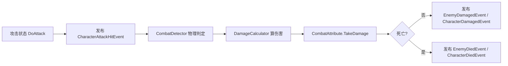

# 21. 角色打击感与手感调优 策划方案

> 配套：《22.角色打击感与手感调优 手把手实现手册》
> 定位：规划"命中反馈"系统，让「打中人」和「被人打」都有重量感和爽感。**不改伤害数值、不改判定逻辑**，只做反馈层。

---

## 一、目标与范围

### 1.1 目标

让每一次"命中"都产生**即时的、多通道的反馈**——视觉、听觉、动觉（时间与位移）一起作用，使战斗"有手感"。

### 1.2 范围（本阶段做 6 件事）

| 元素 | 一句话效果 |
| -- | -- |
| 顿帧 Hit-Stop | 命中瞬间画面短暂"卡一下"，强调打击点 |
| 震屏 Camera Shake | 命中/被命中时镜头轻微震动 |
| 音效 SFX | 命中/受击播放音效 |
| 打击特效 VFX | 命中点爆出火花/光效 |
| 击退 Knockback | 被打的一方沿攻击方向被推开 |
| 受击闪光 Hit Flash | 被打的一方短暂闪白/闪红（shader） |

### 1.3 明确不做（范围外）

- 不改伤害公式、不改攻击判定框。
- 不做受击动作的击退位移帧（那是动画层，本阶段用物理位移实现击退）。
- 不做命中暂停的"变速镜头（speed ramp）"，只做全局时间缩放顿帧。
- 不做角色受击时的"屏幕变红/暗角"后期效果（那是后期处理，可作为后续）。

---

## 二、现状梳理：战斗数据流（先看清管道）

现有链路（已实现，能正常伤害）：



### 关键缺口（本方案要先补的数据源）

我核对了 `CombatAttribute.TakeDamage` 与两个受伤事件，发现**命中信息没有传出来**：

1. `CharacterDamagedEvent` / `EnemyDamagedEvent` 里都有 `FromDirection` 字段，但发布时写死 `Vector3.zero`。
2. 事件里**没有"命中点"（HitPoint）**，特效不知道该在哪生成。
3. `TakeDamage(float damageAmount)` 的签名**没有接收攻击者位置/方向**。

> 结论：顿帧/震屏/音效只需要"知道命中发生了"就能做；但**特效、击退、受击闪光**需要"命中点 + 方向 + 受害者"。所以必须先补一条"命中信息管道"（手册阶段零）。

---

## 三、整体架构：事件驱动 + 效果组件

延续项目一贯的 `EventBus` + 组件解耦风格，**每个手感元素做成一个独立组件，各自订阅事件**，互不依赖、可单独开关。

```text
伤害事件（数据源）
EnemyDamagedEvent / CharacterDamagedEvent
  ├─ HitPoint     命中点（特效用）
  ├─ FromDirection 攻击来向（击退/闪光用）
  └─ Victim        受害者（怪物事件已有，闪光定位用）
        │ 广播
        ├── HitStopController   顿帧     —— 全局时间缩放（单例）
        ├── CameraShake         震屏     —— 挂 Camera
        ├── HitAudioPlayer      音效     —— 命中音效
        ├── HitVfxSpawner       打击特效 —— 命中点生成粒子
        ├── KnockbackReceiver   击退     —— 挂受击实体，响应位移
        └── HitFlash            受击闪光 —— 挂受击实体，shader 闪白
```

### 三条设计原则

1. **只订阅、不互相调用**：各效果组件只订阅事件，不做相互引用，谁想加/减效果直接挂/删组件。
2. **顿帧是全局的、必须单点**：`Time.timeScale` 是全局变量，若多个组件同时改会互相打架，所以顿帧用**单例**集中管理——复用项目已有的 `MonoSingleton<T>` 基类（`Emberwild.Core.Singleton`），不要自己写静态 `Instance`。
3. **震屏/特效/闪光用 `unscaledDeltaTime`**：顿帧期间 `Time.deltaTime` 会变慢甚至停止，这些效果要用 `Time.unscaledDeltaTime`，否则会跟着一起冻结。

---

## 四、六个手感元素逐个说明

### 4.1 顿帧 Hit-Stop（最易，全局）

**效果**：命中瞬间把 `Time.timeScale` 拉到很低（如 0 或 0.1）维持几十毫秒，再恢复 1。玩家会感觉"这一下打实了"。

| 参数 | 建议初始值 | 调优方向 |
| -- | -- | -- |
| 顿帧时长 | 0.04~0.06 秒 | 太长卡顿感强，太短没感觉；重击可 0.08 |
| 时间缩放 | 0（全冻结）或 0.05 | 0 最"硬"，0.1 保留一丝动感 |
| 触发阈值 | 所有命中都触发 | 可后续按"重击/暴击"分级 |

**坑点**：
- 计时必须用 `Time.unscaledDeltaTime` / `WaitForSecondsRealtime`，否则顿帧自身也冻住回不来。
- 顿帧期间所有 `Time.deltaTime` 驱动的东西都会变慢（这是预期，不是 bug）。
- 连续命中要"重置计时"而非叠加冻结。

### 4.2 震屏 Camera Shake（易）

**效果**：命中/被命中时镜头做衰减随机抖动，传递"冲击力"。

| 参数 | 建议 | 调优方向 |
| -- | -- | -- |
| 震动强度（位移） | 0.1~0.3 米 | 被重击可加大 |
| 震动强度（角度） | 1~3 度 | 轻微旋转更有"晃动感" |
| 衰减速度 | 1~2 秒归零 | 越快越"干脆" |

**实现思路**：用"创伤值（trauma）"模型——命中加 trauma，每帧用 `unscaledDeltaTime` 衰减，震动幅度 = trauma² × 基础强度，位置用 Perlin 噪声取连续随机。这是 GDC《Juice it or lose it》的经典做法。

**坑点**：必须 `unscaledDeltaTime`（顿帧期间继续震）；相机偏移要**叠加**在 `CameraController` 的跟随结果上（脚本执行顺序放它之后），不能覆盖。

### 4.3 音效 SFX（易，需素材）

**效果**：命中播放打击音效。命中与受击可用不同音。

**需要你准备**：命中音效 1 个（打击/挥砍）、受击音效 1 个（闷响/叮）。格式 `.wav` 或 `.ogg`，短促（<1 秒）。

**坑点**：`AudioSource.PlayClipAtPoint` 每次会新建临时对象，频繁命中要改用一个常驻 `AudioSource` 复用；**随机音高（pitch 0.9~1.1）**能明显减少重复感。

### 4.4 打击特效 VFX（中）

**效果**：在命中点生成火花/爆点粒子。

**数据依赖**：命中点 `HitPoint`（阶段零补上）。

**需要你准备**：一个命中粒子预制体。可参考美术包里已有的 `FX Spark.prefab`，或新建一个（若干粒子 + 短生命周期 + 小光点）。

**坑点**：粒子生命周期要短（0.2~0.4 秒）并自动销毁；命中点要传世界坐标；后续量大了再上对象池（本阶段先 `Instantiate` + 自动回收）。

### 4.5 击退 Knockback（中难）

**效果**：被打的一方沿攻击方向被推开一段距离。

**数据依赖**：攻击来向 `FromDirection`（阶段零补上）。

**实现思路**：受击实体的移动组件加一个"击退速度信箱"，击退期间**优先于**移动输入，随时间衰减归零。

- 玩家：`CharacterLocomotionMotor.FixedUpdate` 目前每帧用 `DesiredHorizontalVelocity` 覆盖 `v.x/v.z`，需加一个 `KnockbackVelocity`，击退期间优先写入。
- 怪物：`CustomNavAgent` 加击退（或 `EnemyBrain`/`EnemyCombat` 响应受击直接推）。

**坑点**：物理信箱冲突（FixedUpdate 每帧覆盖 velocity）是最大的坑；击退方向要压平 Y（水平击退）或按需保留 Y（浮空击退）；击退期间通常要锁移动/攻击（可选）。

### 4.6 受击闪光 Hit Flash（最难，含 shader）

**效果**：被打的一方身体短暂闪白/闪红后快速消退。

**为什么涉及 shader**：角色/怪物用的是标准材质，默认无法"整身变白"。需要一个能接受"闪白强度"参数的着色器，受击时用脚本把强度拉高再衰减。

**两种实现（手册里从易到难都讲）**：
1. **方案 A（不写 shader）**：用 `MaterialPropertyBlock` 直接改材质自发光 `_EmissionColor`——最简单，但要求材质开了 emission，且视觉偏"发光"而非"闪白"。
2. **方案 B（写 shader，推荐掌握）**：写一个简单 shader，加 `_HitFlashColor` / `_HitFlashAmount` 两个属性，片元阶段把 `_HitFlashAmount` 混到最终颜色。受击时脚本用 `MaterialPropertyBlock` 把 `_HitFlashAmount` 拉到 1，再逐帧衰减到 0。**不改材质实例、不产生新材质，多个怪共用一份材质也能独立闪**。

**坑点**：`MaterialPropertyBlock` 只影响当前渲染帧，不影响材质资源本身；要针对 `SkinnedMeshRenderer`（角色/怪物是蒙皮网格）；flash 衰减要在脚本里用 `unscaledDeltaTime` 驱动；多个 Renderer 要一起设置。

---

## 五、阶段划分（从易到难，每步可验证）

| 阶段 | 内容 | 难度 | 依赖 | 预计 |
| -- | -- | -- | -- | -- |
| **零** | 伤害事件补全（命中点 + 方向管道） | 前置 | — | 0.5h |
| **一** | 顿帧 Hit-Stop | ★ 易 | — | 0.5h |
| **二** | 震屏 Camera Shake | ★ 易 | — | 0.75h |
| **三** | 音效 SFX | ★ 易 | 素材 | 0.5h |
| **四** | 打击特效 VFX | ★★ 中 | 阶段零（命中点） | 1h |
| **五** | 击退 Knockback | ★★★ 中难 | 阶段零（方向） | 1.5h |
| **六** | 受击闪光 Hit Flash | ★★★★ 难 | 阶段零（受害者） | 2h |

> 顺序理由：顿帧/震屏/音效只依赖"命中发生了"，先做能立刻看到反馈；特效/击退/闪光依赖命中点与方向，放在阶段零之后。shader 最难，放最后。

---

## 六、资源清单（需要你自行准备）

| 资源 | 数量 | 说明 | 在哪个阶段用 |
| -- | -- | -- | -- |
| 命中音效 | 1 个 | 短促打击声（.wav/.ogg） | 阶段三 |
| 受击音效 | 1 个 | 短促闷响/受击声 | 阶段三 |
| 命中粒子预制体 | 1 个 | 火花/爆点（可参考美术包 FX Spark） | 阶段四 |
| 受击闪光材质 | 复用现有怪物/角色材质 | shader 方案 B 用 | 阶段六 |
| 可选：角色/怪物贴图 | — | 闪光效果更明显时可调 | 阶段六 |

> 前四个阶段（顿帧/震屏）**不需要任何素材**，可直接开做。

---

## 七、风险与应对

| 风险 | 影响 | 应对 |
| -- | -- | -- |
| 顿帧改动全局 `Time.timeScale` | 影响 UI/动画/物理节奏 | 单例集中管理；异常退出兜底恢复；后续可只冻结"角色层"（用 Animator.speed 代替全局缩放） |
| 击退与现有速度信箱冲突 | 位移抖动/溜冰 | 击退速度独立信箱 + 明确优先级 + 衰减归零后交还移动控制 |
| 震屏叠加顺序错误 | 镜头跳变 | 用 `[DefaultExecutionOrder]` 保证在 CameraController 之后执行 |
| 闪光 shader 写错导致材质变黑/变紫 | 画面错误 | 手册给最小可用的 shader + 逐行解释 + 常见报错对照 |
| 特效频繁 Instantiate | GC 卡顿 | 本阶段先简单实现，手册附对象池优化方向 |
| 音效素材缺失 | 阶段三无法验收 | 可先用 Unity 里任意临时音效占位，跑通逻辑后再替换 |

---

## 八、验收标准（每阶段）

- **阶段零**：命中时 Console 打印的 `HitPoint` / `FromDirection` 非零且方向正确。
- **阶段一**：打中怪瞬间画面卡一下（顿帧），顿帧后一切恢复。
- **阶段二**：命中时镜头轻微抖动，衰减平滑无跳变。
- **阶段三**：命中/受击有音效，连续命中不爆音不卡顿。
- **阶段四**：命中点爆出火花，位置正确，粒子自动消失。
- **阶段五**：怪被打会沿攻击方向后退，衰减自然，不影响正常追击。
- **阶段六**：怪被打瞬间闪白并快速消退，多只怪各自独立闪、互不串扰。
- **回归**：上述改动不破坏已有的追敌/攻击/缩壳/受击死亡/多怪独立逻辑。
